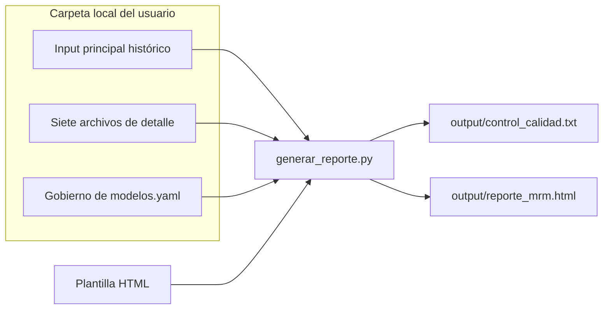

# Score MRM 2.0

Reporte HTML de indicadores de riesgo de modelo del COE Model Risk Management. Toma información de archivos Excel, calcula un puntaje de 0 a 100 por indicador, driver y modelo, y genera una sola página interactiva con filtros.

> **Importante:** este repositorio es público y no incluye datos. Cada persona trabaja con los Excel de su carpeta local, que Git ignora. No subas esos archivos ni el reporte generado.

## Inicio rápido

Necesitas [Python 3.10 o superior](https://www.python.org/downloads/), [Visual Studio Code](https://code.visualstudio.com/) y los inputs en una carpeta de tu equipo: el input principal histórico, los siete archivos de detalle y `Gobierno de modelos.yaml`.

1. Clona el repositorio y abre la carpeta en Visual Studio Code.
2. Abre `Terminal > Run Task…` y ejecuta **1. Preparar entorno** (solo la primera vez). Esto crea tu archivo `config.yaml`.
3. Abre `config.yaml` e indica en `carpeta_inputs` la carpeta de tus inputs. Si los nombres de tus archivos son otros, ajústalos en `archivos`.
4. Presiona `Ctrl+Shift+B` para generar el reporte. Se abrirá en tu navegador y la revisión de calidad de datos quedará en `output/control_calidad.txt`.

El reporte queda en `output/reporte_mrm.html`. Incluye los datos, así que compártelo solo con quien corresponda. Necesita internet al abrirse, porque carga los estilos desde un CDN.

También puedes hacerlo todo con un solo comando, que explica cada paso y te pide la carpeta de tus Excel:

```bash
python ejecutar.py
```

La guía paso a paso, con la alternativa por terminal y la solución de errores frecuentes, está en [docs/guia_vscode.md](docs/guia_vscode.md).

## Qué muestra el reporte

| Sección | Contenido |
|---|---|
| **Reporte** | Indicadores de cabecera, evolutivo del score y tablero con los 16 indicadores, con simulador de valores |
| **Macro** | Mapas de calor por Model User y por Banca y Producto, e indicadores por modelo |
| **Seguimiento** | Cobertura de seguimiento, alertas, tiempo de atención (TTM) y plan de acción |
| **Validación** | Cobertura metodológica y de implementación, calificaciones y próximas descoberturas |
| **Observaciones** | Observaciones de validación y de SBS y auditoría interna, con su detalle |
| **Implementación** | Ambientes de despliegue y data, plataformas y calidad de datos |
| **Inventario** | Modelos input de cada modelo, mapa por proceso y altas y bajas del último mes |
| **Gobierno** | Flujos del gobierno de modelos, aprobaciones, comités, aplicabilidad por perímetro, definición de indicadores, mapa normativo, flujo de información y nota de gobierno por PO usuario |

Los bloques que vienen de archivos de detalle solo se muestran con el último mes seleccionado. Los filtros permiten selección múltiple, salvo Fecha, y los umbrales del semáforo dependen de los Tier elegidos.

## Cómo funciona



Python lee los inputs, revisa su calidad, une la información por ID de modelo y la inserta en la plantilla. Los indicadores se calculan en el navegador, para que se actualicen con cada filtro.

## Estructura del proyecto

```text
Score-MRM-2.0/
├── ejecutar.py        Ejecución guiada, paso a paso
├── config.ejemplo.yaml  Plantilla de tu config.yaml local
├── requirements.txt   Dependencias de Python
├── docs/              Documentación
├── src/               Código del proceso
│   ├── generar_reporte.py     Lee, valida, une y genera el reporte
│   ├── esquema.py             Campos y tipos de dato de cada archivo
│   ├── calidad.py             Controles de calidad de datos
│   └── generar_diccionario.py Crea el diccionario de datos en Excel
├── templates/         Plantilla del reporte: diseño e indicadores
├── tests/             Pruebas automáticas
├── .vscode/           Tareas y configuración de Visual Studio Code
├── config.yaml        Tu configuración local (no se sube a Git)
└── output/            Reporte generado (no se sube a Git)
```

## Documentación

| Documento | Para qué sirve |
|---|---|
| [Guía de Visual Studio Code](docs/guia_vscode.md) | Instalar, ejecutar el proceso, revisar el reporte y resolver errores |
| [Proceso](docs/proceso.md) | Qué hace cada etapa, de los Excel al reporte |
| [Datos de entrada](docs/datos.md) | Archivos, relaciones y reglas de uso |
| [Diccionario de datos](docs/referencia/Diccionario_de_datos.xlsx) | Campos de cada archivo con su tipo de dato |
| [Calidad de datos](docs/calidad_datos.md) | Proceso, controles, niveles y mejoras propuestas |
| [Indicadores](docs/indicadores.md) | Cálculo de indicadores, drivers, score y puntos por definir |
| [Actualización mensual](docs/actualizacion_mensual.md) | Qué hacer cada mes para actualizar el reporte |
| [Cambios de la versión 2](docs/cambios_v2.md) | Qué cambió respecto de la versión 1 |

## Estado

Versión 2 del MVP, cerrada. Los cambios están en [docs/cambios_v2.md](docs/cambios_v2.md) y las definiciones pendientes están en [docs/indicadores.md](docs/indicadores.md#puntos-por-definir).

## Tecnologías

Python, [openpyxl](https://openpyxl.readthedocs.io/), [PyYAML](https://pyyaml.org/) y [Tabler](https://tabler.io/) (licencia MIT).
