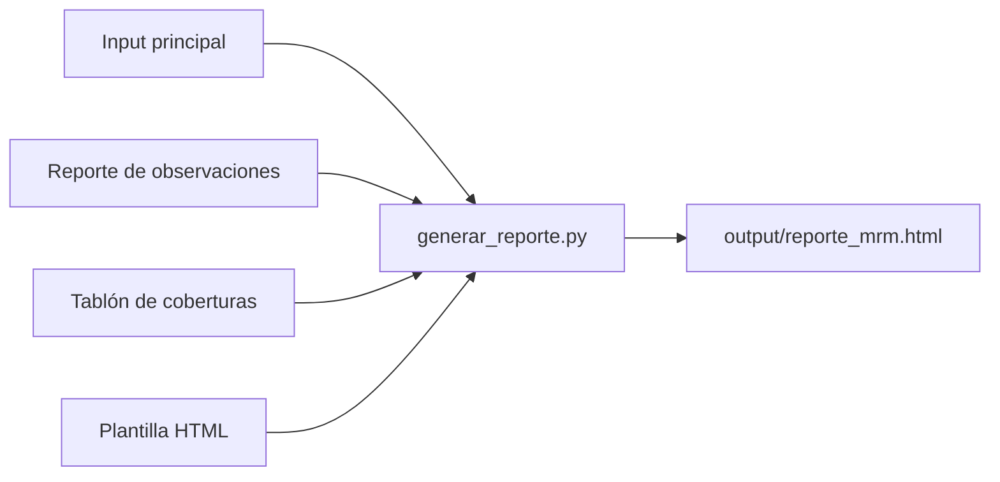

# Score MRM 2.0

Reporte HTML de indicadores de riesgo de modelo del COE Model Risk Management. Toma información de archivos Excel, calcula un puntaje de 0 a 100 por indicador, driver y modelo, y genera una sola página interactiva con filtros.

> **Importante:** este repositorio es público y los datos incluidos son simulados, solo para pruebas. No subas información real. Para trabajar con datos reales, usa un repositorio privado o deja los archivos fuera de Git.

## Inicio rápido

Necesitas [Python 3.10 o superior](https://www.python.org/downloads/) y [Visual Studio Code](https://code.visualstudio.com/).

1. Clona el repositorio y abre la carpeta en Visual Studio Code.
2. Abre `Terminal > Run Task…` y ejecuta **1. Preparar entorno** (solo la primera vez).
3. Presiona `Ctrl+Shift+B` para generar el reporte. Se abrirá en tu navegador.

El reporte queda en `output/reporte_mrm.html`. Necesita internet al abrirse, porque carga los estilos desde un CDN.

La guía paso a paso, con la alternativa por terminal y la solución de errores frecuentes, está en [docs/guia_vscode.md](docs/guia_vscode.md).

## Qué muestra el reporte

| Sección | Contenido |
|---|---|
| **Reporte** | Indicadores de cabecera, evolutivo del score y tablero con los 16 indicadores |
| **Macro** | Mapas de calor por Model User y por Banca y Producto, e indicadores por modelo |
| **Seguimiento** | Cobertura de seguimiento, alertas, tiempos de atención (TTM) y mitigantes |
| **Validación** | Cobertura metodológica y de implementación, calificaciones y próximas descoberturas |
| **Observaciones** | Observaciones pendientes y vencidas, con su detalle y recomendación |
| **Implementación** | Ambientes de despliegue y data, ratios y plataformas |
| **Gobierno** | Flujo de información y explicación de cada puntuación |

## Cómo funciona



Python lee y valida los Excel, une la información por ID de modelo y la inserta en la plantilla. Los indicadores se calculan en el navegador, para que se actualicen con cada filtro.

## Estructura del proyecto

```text
Score-MRM-2.0/
├── config.yaml        Rutas de los archivos y opciones del proceso
├── requirements.txt   Dependencias de Python
├── data/              Excel de entrada
├── docs/              Documentación
├── src/               Código del proceso
│   ├── generar_reporte.py
│   └── simular_historico.py
├── templates/         Plantilla del reporte: diseño e indicadores
├── tests/             Pruebas automáticas
├── .vscode/           Tareas y configuración de Visual Studio Code
└── output/            Reporte generado (no se sube a Git)
```

## Documentación

| Documento | Para qué sirve |
|---|---|
| [Guía de Visual Studio Code](docs/guia_vscode.md) | Instalar, correr el proceso y resolver errores |
| [Proceso](docs/proceso.md) | Qué hace cada etapa, de los Excel al reporte |
| [Datos de entrada](docs/datos.md) | Archivos, columnas, cruces y controles de calidad |
| [Indicadores](docs/indicadores.md) | Cálculo de indicadores, drivers, score y puntos por definir |
| [Actualización mensual](docs/actualizacion_mensual.md) | Qué hacer cada mes para actualizar el reporte |

## Estado

Primer MVP, con datos simulados. Mayo, junio y julio de 2026 se simulan a partir de agosto para probar los evolutivos. Las definiciones pendientes están en [docs/indicadores.md](docs/indicadores.md#puntos-por-definir).

## Tecnologías

Python, [openpyxl](https://openpyxl.readthedocs.io/), [PyYAML](https://pyyaml.org/) y [Tabler](https://tabler.io/) (licencia MIT).
