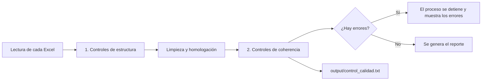

# Calidad de datos

Cada vez que se genera el reporte, el proceso revisa los ocho archivos de entrada antes de usarlos. El resultado queda en `output/control_calidad.txt`, junto al reporte, y su resumen aparece en la terminal.

## Cómo funciona

1. **Controles de estructura:** se comparan las columnas, los tipos de dato, los vacíos y los catálogos con el esquema de `src/esquema.py`. Es la misma definición que el [diccionario de datos](referencia/Diccionario_de_datos.xlsx).
2. **Limpieza y homologación:** se quitan espacios sobrantes y caracteres invisibles, se normaliza el ID del modelo y se aplican las equivalencias de `homologacion` en `config.yaml`.
3. **Controles de coherencia:** se revisan reglas entre campos de un mismo archivo y entre archivos.

El código de los controles está en `src/calidad.py`.

## Niveles

| Nivel | Qué significa | Qué hace el proceso | Qué hacer |
|---|---|---|---|
| **ERROR** | No se puede generar un reporte confiable | Se detiene y muestra el motivo | Corregir el archivo y volver a generar |
| **ALERTA** | El reporte se genera, pero una cifra puede no ser correcta | Continúa | Revisar con el dueño del archivo |
| **AVISO** | Tema de formato o completitud que el proceso ya resuelve o que no cambia las cifras | Continúa | Corregir en la fuente cuando sea posible |

## Reglas generales

| Regla | Detalle |
|---|---|
| Llave única | Todos los archivos se unen por el número del modelo. Se acepta `21122`, `MOD-BCP-21122` o `MOD-BCP-0000177`; el código original se conserva en `CODIGO_MODELO` |
| Último mes | Los archivos de detalle solo se cruzan con los modelos del último mes del input principal. Los registros de otros modelos se cuentan y se excluyen |
| Archivos opcionales | Solo el input principal es obligatorio. Si falta un archivo de detalle, se registra una alerta y su bloque no se muestra |
| Nota de Gobierno | Se une por PO usuario y model developer. Si un PO tiene una sola fila, se usa esa fila |
| Observaciones SBS & AI | Una celda con varios modelos se separa en una fila por modelo. Las que no tienen modelo se muestran como transversales. Solo el estado "Pendiente" cuenta como pendiente |
| Datos personales | El correo de Observaciones SBS & AI no se incluye en el reporte |

## Controles de estructura

Se aplican a todos los archivos, según `src/esquema.py`.

| Control | Nivel |
|---|---|
| Falta una columna que el reporte necesita | ERROR |
| Falta una columna informativa | AVISO |
| Hay columnas que no están en el esquema (se ignoran) | AVISO |
| Una columna está vacía en todas las filas | ALERTA si es obligatoria, AVISO si no |
| Vacíos en un campo obligatorio | ALERTA |
| Valores que no cumplen el tipo de dato | ALERTA |
| Fechas anteriores a 1990, usadas como relleno | ALERTA |
| Valores fuera del catálogo | ALERTA |
| Textos con espacios sobrantes (se limpian) | AVISO |

## Controles de coherencia

### Input principal histórico

| Control | Nivel |
|---|---|
| Modelo repetido en una misma fecha | ERROR |
| ID de modelo sin número | ERROR |
| Quiebre de la serie: altas y bajas superan el 10% de los modelos entre dos meses | ALERTA |
| Meses con total 0 de observaciones entre meses con dato | ALERTA |
| Categorías que solo aparecen en meses anteriores | AVISO |
| Modelos cuyo nombre cambia entre meses | AVISO |
| Nombres usados por más de un ID | AVISO |
| "Sin Seguimiento" marcado "En alerta" | ALERTA |
| Modelos en alerta sin mitigante o sin situación de TTM | ALERTA |
| Modelos sin alerta con datos de alerta | ALERTA |
| `EXCEDE_TTM` no coincide con el signo de `EXCESO_MESES_TTM` | ALERTA |
| `NOTA_CALIDAD_DATOS` igual a 0 | ALERTA |
| Más observaciones vencidas que pendientes | ALERTA |
| "Sin Seguimiento" con nota de profundidad del seguimiento, o "Con Seguimiento" sin ella | AVISO |
| Mitigante "Si" con descripción "No aplica" | AVISO |
| Ambiente informado con plataforma sin información | AVISO |
| `IMPACTO` con texto en lugar de un monto | AVISO |

### Archivos de detalle

| Archivo | Control | Nivel |
|---|---|---|
| Inventario | ID repetido | ERROR |
| Inventario | Modelos del score que no están en el inventario | ALERTA |
| Inventario | Modelo declarado como modelo input de sí mismo (se ignora) | ALERTA |
| Inventario | Modelos input que no existen en el inventario | ALERTA |
| Inventario | Estado distinto al del input principal (se usa el del input) | AVISO |
| Inventario | Modelos sin modelo input declarado o sin descripción | AVISO |
| TTM | Modelos en alerta sin fila en el archivo, o filas de modelos que no están en alerta | ALERTA |
| TTM | Holgura distinta de `EXCESO_MESES_TTM` del input | ALERTA |
| TTM | "No tiene TTM" en el input pero con TTM de gobierno en el archivo | ALERTA |
| TTM | La holgura no es TTM real menos TTM de gobierno | ALERTA |
| TTM | Diagnóstico y plan de acción idénticos en todas las filas | AVISO |
| Reporte de observaciones | Conteos por modelo distintos de los del input principal | ALERTA |
| Reporte de observaciones | Filas repetidas (se cuenta una) | AVISO |
| Observaciones SBS & AI | Pendientes y vencidas por modelo distintas de las del input principal | ALERTA |
| Observaciones SBS & AI | Observaciones sin modelo o con varios modelos en una celda | AVISO |
| Nota de Gobierno | PO usuario y model developer repetidos | ERROR |
| Nota de Gobierno | Modelos sin nota | ALERTA |
| Nota de Gobierno | Nota distinta de `NOTA_GOBIERNO` del input principal | ALERTA |
| Nota de Gobierno | La nota no es el promedio de sus componentes con dato | ALERTA |
| Nota de Gobierno | Filas sin modelos en el último mes | AVISO |
| Calidad de Datos | El indicador no es la suma de sus criterios | ALERTA |
| Calidad de Datos | Rango de cumplimiento incoherente con el indicador | ALERTA |
| Calidad de Datos | Todos los criterios en 0 | ALERTA |
| Calidad de Datos | Indicador distinto de `NOTA_CALIDAD_DATOS` del input, o nota sin detalle | ALERTA |
| Tablón de coberturas | Modelos sin registro | ALERTA |
| Tablón de coberturas | `VALIDACION_PERIODICA` distinta de `Cobertura_Global` | ALERTA |
| Tablón de coberturas | Cobertura vigente con fecha de descobertura ya pasada | ALERTA |

En todos los archivos de detalle también se avisa cuántos registros son de modelos fuera del último mes y no se incluyen.

## Resultados con la base de desarrollo

Base simulada de setiembre de 2026, con 312 modelos: **0 errores, 22 alertas y 37 avisos**. Los principales hallazgos:

| Archivo | Hallazgo | Casos |
|---|---|---|
| Input principal | Quiebre de la serie en junio de 2026 | 42 altas y 65 bajas |
| Input principal | `OBS_SBS_AI_PENDIENTES` en 0 en cinco meses | Ene, Feb, Mar, May y Jun |
| Input principal | "Saludable" y "Aceptable" solo hasta abril | 715 filas |
| Input principal | `NOTA_CALIDAD_DATOS` igual a 0 | 21 de 40 |
| Reporte de observaciones | Críticas, relevantes y moderadas: detalle frente a input | 165 frente a 143 pendientes |
| Observaciones SBS & AI | Observaciones sin modelo | 19 |
| Observaciones SBS & AI | Pendientes que no cuadran con el input | 2 modelos |
| TTM | "No tiene TTM" en el input pero con TTM de gobierno | 4 |
| Nota de Gobierno | Modelos sin nota | 3 |
| Calidad de Datos | Criterios con valor negativo | 2 |
| Calidad de Datos | Rango incoherente con el indicador | 4 |
| Inventario | Fechas de inicio y retiro con relleno (1899, 1900 o 1970) | 433 y 311 |
| Tablón de coberturas | Cobertura vigente con fecha de descobertura pasada | 8 |

## Mejoras propuestas en las fuentes

| # | Mejora | Archivos |
|---|---|---|
| 1 | Usar un solo campo `ID_MODELO` numérico en todos los archivos | Todos |
| 2 | Agregar la fecha de corte a cada archivo | TTM, SBS & AI, Gobierno, Calidad, Inventario |
| 3 | Una fila por observación y modelo, y una marca explícita para las transversales | Observaciones SBS & AI |
| 4 | Agregar `ID_MODELO`, o usar el mismo catálogo de áreas que el input principal | Nota de Gobierno |
| 5 | Distinguir "no evaluado" de una nota 0 | Calidad de Datos e input principal |
| 6 | Guardar las fechas como fecha, sin rellenos de 1899, 1900 o 1970 | Inventario, Tablón, SBS & AI |
| 7 | Mantener las categorías estables entre meses | Input principal |
| 8 | Completar las columnas vacías o retirarlas | TTM (`MITIGANTE`, `NUEVA_FECH_SUBSANACION`), Reporte de observaciones (`Fecha cierre`) |
| 9 | Definir el significado de `MODELOELIMINADO` | Inventario |
| 10 | Confirmar los pesos de los criterios de calidad de datos | Calidad de Datos |

## Cómo agregar o cambiar un control

- **Un campo, su tipo o su catálogo:** edita `src/esquema.py` y vuelve a crear el diccionario con `python src/generar_diccionario.py`.
- **Una regla entre campos o archivos:** agrégala en `controles_cruzados` de `src/calidad.py`, con su nivel.
- **Una equivalencia de catálogo:** agrégala en `homologacion` de `config.yaml` y en `config.ejemplo.yaml`.
- Luego ejecuta las pruebas: `python -m unittest discover -s tests`.
