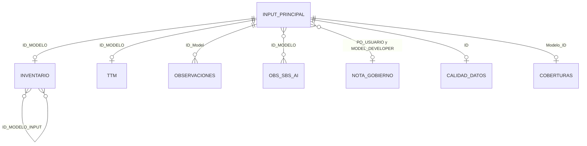

# Datos de entrada

## Carpeta local

El repositorio no contiene inputs. Cada persona guarda los Excel en una carpeta de su equipo y la indica en `carpeta_inputs` de su `config.yaml`. Git ignora `config.yaml`, los Excel y el reporte generado.

El proceso lee la primera hoja de cada Excel, con los títulos en la primera fila.

## Archivos

| Archivo | Obligatorio | Granularidad | Llave del modelo | Sección |
|---|---|---|---|---|
| Input principal histórico | Sí | Una fila por modelo y fecha de corte | `ID_MODELO` | Todas |
| Inventario de modelos | No | Una fila por modelo | `ID_MODELO` | Inventario |
| TTM | No | Una fila por modelo en alerta | `ID_MODELO` | Seguimiento |
| Reporte de observaciones | No | Una fila por observación de validación | `ID_Model` | Observaciones |
| Observaciones SBS & AI | No | Una fila por observación de SBS o auditoría interna | `ID_MODELO` | Observaciones |
| Nota de Gobierno | No | Una fila por PO usuario y model developer | `PO_USUARIO` y `MODELO_DEVELOPER` | Gobierno |
| Calidad de Datos | No | Una fila por modelo evaluado | `ID` | Implementación |
| Tablón de coberturas | No | Una fila por modelo | `Modelo_ID` | Validación |

Los nombres de los archivos se definen en `archivos` de `config.yaml`.

**Campos y tipos de dato:** están en el [anexo de la guía de Visual Studio Code](guia_vscode.md#anexo-archivos-de-entrada) y en el [diccionario de datos](referencia/Diccionario_de_datos.xlsx), con una hoja por archivo. Ambos se generan desde `src/esquema.py`, que es la definición que usa el proceso.

`docs/referencia/Indicadores.xlsx` documenta las medidas de Power BI (DAX) y no se lee en el proceso.

## Cómo se relacionan

- **Llave:** el número del modelo. Se acepta `21122`, `MOD-BCP-21122` o `MOD-BCP-0000177`.
- **Último mes:** los archivos de detalle solo se cruzan con los modelos del último mes del input principal.
- **Varios modelos en una celda:** en Observaciones SBS & AI y en `ID_MODELO_INPUT` del inventario se separan en una fila por modelo.

## Reglas de uso

| Archivo | Regla |
|---|---|
| Input principal | Es la base: calcula los indicadores, el score y los evolutivos |
| Inventario | Aporta los modelos input (`ID_MODELO_INPUT`), el código completo de cada modelo y las fechas de inicio y retiro para las altas y bajas. El estado del modelo sale del input principal |
| TTM | Agrega fecha de alerta, plan de acción y tiempos de atención a los modelos en alerta |
| Reporte de observaciones | Los días vencidos se calculan desde el compromiso vigente (`Fecha ampliada` si existe, si no `Fecha estimada`) |
| Observaciones SBS & AI | Solo el estado "Pendiente" cuenta como pendiente. Las observaciones sin modelo se muestran como transversales. El correo no se incluye en el reporte |
| Nota de Gobierno | Se asigna por PO usuario y model developer; si el PO tiene una sola fila, por PO. Las áreas se homologan en `config.yaml` |
| Calidad de Datos | Cada criterio se muestra como porcentaje de su peso |
| Tablón de coberturas | Las fechas de descobertura van como `d/mm/aaaa` |

## Contenido de Gobierno

El contenido de la sección Gobierno no es un input mensual: está en el repositorio, en `contenido/gobierno_modelos.yaml`, y llega a todos con **Git: Pull**. Se edita a mano y tiene estas secciones:

| Sección | Qué contiene |
|---|---|
| `roles` | Áreas que participan en los flujos y su línea de defensa |
| `flujos` | Procesos del gobierno de modelos, con sus pasos, responsables, entradas, salidas y aprobaciones |
| `aprobaciones` | Instancia que aprueba cada asunto, para Tier I y para Tier II a IV |
| `comites` | Comités, de mayor a menor instancia |
| `ambitos` | Etapas del gobierno que aplican a cada perímetro |
| `indicadores` | Qué mide y por qué importa cada indicador, por clave |
| `mapa_normativo` | Normas y políticas de modelos, por grupo |
| `flujo_informacion` | Fuentes del reporte (owner, recurrencia, fecha de corte, sistema e indicadores que alimentan) y proceso de actualización |

Un texto `[Por confirmar]` se muestra resaltado en el reporte. Después de editarlo, vuelve a generar el reporte y sube el cambio al repositorio.

## Controles de calidad

El proceso revisa los archivos en cada corrida y guarda el resultado en `output/control_calidad.txt`. Los controles, sus niveles y las mejoras propuestas están en [calidad_datos.md](calidad_datos.md).
