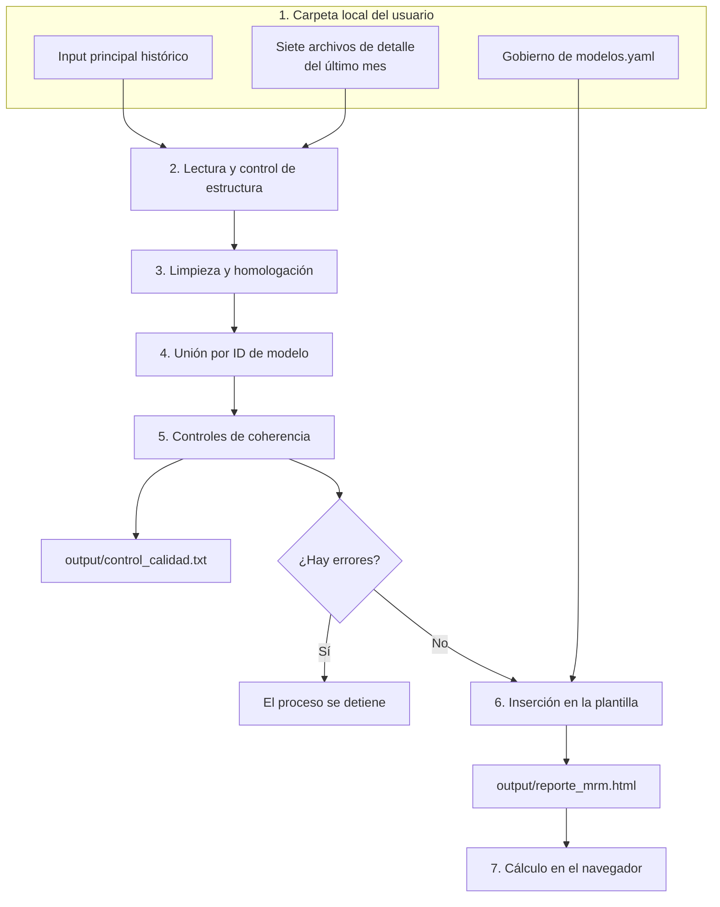

# Proceso

Este documento explica cómo se transforma la información de los Excel en el reporte.

## Flujo

## Etapas

### 1. Información

Cada usuario guarda los Excel en una carpeta de su equipo y la indica en su `config.yaml`. El repositorio no contiene datos. El detalle de cada archivo está en [Datos de entrada](datos.md).

### 2. Lectura y control de estructura

`src/generar_reporte.py` lee cada Excel y lo compara con el esquema de `src/esquema.py`: columnas, tipos de dato, vacíos y catálogos. El proceso se detiene si:

- Falta el input principal.
- Falta una columna que el reporte necesita.
- Un modelo se repite en una misma fecha o no tiene ID con número.

Si falta un archivo de detalle, el proceso continúa y su bloque no se muestra. `Gobierno de modelos.yaml` no pasa por estos controles: se lee tal cual y, si está mal formado, el proceso se detiene.

### 3. Limpieza y homologación

Se quitan espacios sobrantes y caracteres invisibles, se normaliza el ID del modelo y se aplican las equivalencias de `homologacion` en `config.yaml`.

### 4. Unión por ID de modelo

La tabla base es el input principal. Los archivos de detalle se unen solo con los modelos de la **última fecha** del input. Los registros de otros modelos se cuentan y se excluyen. La Nota de Gobierno se une por PO usuario y model developer.

### 5. Controles de coherencia

`src/calidad.py` revisa reglas entre campos y entre archivos, y guarda todos los hallazgos en `output/control_calidad.txt`. El detalle está en [calidad_datos.md](calidad_datos.md).

### 6. Inserción en la plantilla

Los datos se convierten a JSON y reemplazan la marca `/*__DATOS__*/null` de `templates/plantilla_reporte.html`. El resultado es un único archivo HTML que incluye todos los datos.

### 7. Cálculo en el navegador

Los indicadores se calculan en el navegador, como las medidas de un modelo semántico de Power BI. Por eso se recalculan con cada filtro. Las fórmulas están en la plantilla, en el objeto `CFG`.

## Alcance de los datos por sección

| Sección | Fuentes | ¿Qué cambia con el filtro Fecha? |
|---|---|---|
| Reporte, Macro | Input principal | Todo |
| Seguimiento | Input principal y TTM | Todo, salvo el tiempo de atención y el detalle del TTM |
| Validación | Input principal y Tablón de coberturas | Solo el evolutivo |
| Observaciones | Input principal, Reporte de observaciones y Observaciones SBS & AI | Solo el evolutivo |
| Implementación | Input principal y Calidad de Datos | Todo, salvo el bloque de calidad de datos |
| Inventario | Input principal e Inventario de modelos | Solo se muestra en el último mes |
| Gobierno | Gobierno de modelos.yaml y Nota de Gobierno | La tabla de notas solo se muestra en el último mes. La definición de indicadores usa la puntuación de la fecha elegida |

En fechas anteriores, los bloques que vienen de archivos de detalle muestran un aviso, porque esos archivos corresponden solo al último mes.

## Dónde hacer cada cambio

| Quiero cambiar | Archivo |
|---|---|
| Carpeta y nombres de mis Excel | `config.yaml` (local) |
| Valores por defecto para nuevos usuarios | `config.ejemplo.yaml` |
| Equivalencias de catálogos | `homologacion` en `config.yaml` |
| Campos, tipos de dato y catálogos de un archivo | `src/esquema.py`, y luego `python src/generar_diccionario.py` |
| Controles de calidad | `src/calidad.py` |
| Lectura y unión de un archivo | `src/generar_reporte.py` |
| Fórmula o nombre de un indicador | `templates/plantilla_reporte.html`, objeto `CFG` |
| Umbrales del semáforo | `templates/plantilla_reporte.html`, constantes `UMBRAL_BASE`, `UMBRAL_TIER` y `UMBRAL_MIX` |
| Filtros | `templates/plantilla_reporte.html`, constante `DIMS` |
| Secciones, gráficos y estilos | `templates/plantilla_reporte.html` |
| Flujos, aprobaciones, comités, definiciones, mapa normativo y flujo de información de Gobierno | `Gobierno de modelos.yaml` (carpeta de inputs) |
