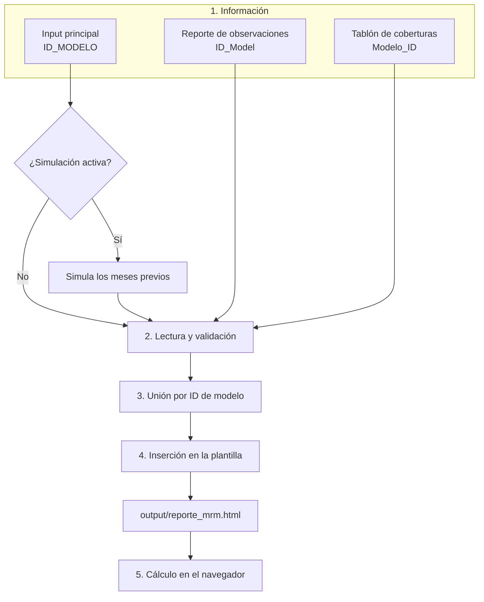

# Proceso

Este documento explica cómo se transforma la información de los Excel en el reporte.

## Flujo

## Etapas

### 1. Información

Los archivos y sus rutas se definen en `config.yaml`. El detalle de cada uno está en [Datos de entrada](datos.md).

### 2. Lectura y validación

`src/generar_reporte.py` lee los Excel, limpia los textos y detiene el proceso con un mensaje claro si:

- Falta un archivo.
- Falta una columna obligatoria.
- Un modelo se repite en una misma fecha.

También lista avisos de calidad de datos, que no detienen el proceso ni cambian el cálculo.

### 3. Unión por ID de modelo

La tabla base es el input principal. Las otras dos se unen con los modelos de la **última fecha** del input:

| Tabla | Campo de unión | Relación |
|---|---|---|
| Input principal | `ID_MODELO` | Base: una fila por modelo y fecha |
| Reporte de observaciones | `ID_Model` | Varias observaciones por modelo |
| Tablón de coberturas | `Modelo_ID` | Una fila por modelo |

Se excluyen los registros de modelos que no están en el input.

### 4. Inserción en la plantilla

Los datos se convierten a JSON y reemplazan la marca `/*__DATOS__*/null` de `templates/plantilla_reporte.html`. El resultado es un único archivo HTML que incluye todos los datos.

### 5. Cálculo en el navegador

Los indicadores se calculan en el navegador, como las medidas de un modelo semántico de Power BI. Por eso se recalculan con cada filtro. Las fórmulas están en la plantilla, en el objeto `CFG`.

## Alcance de los datos por sección

| Sección | Fuentes | ¿Cambia con el filtro Fecha? |
|---|---|---|
| Reporte, Macro, Seguimiento, Implementación | Input principal | Sí |
| Validación | Input principal y Tablón de coberturas | Solo el evolutivo |
| Observaciones | Input principal y Reporte de observaciones | Solo el evolutivo |

En fechas anteriores, Validación y Observaciones muestran el evolutivo y un aviso, porque sus archivos corresponden solo a la última fecha.

## Simulación del historial

El input actual tiene un solo mes (agosto de 2026). Para probar los evolutivos, `src/simular_historico.py` crea mayo, junio y julio con variaciones aleatorias a partir de agosto. Usa una semilla fija, así que el resultado siempre es el mismo.

Los meses simulados se marcan con `SIMULADO = 1` y aparecen en los gráficos con línea punteada y punto hueco. Sus tendencias no tienen significado de negocio. Cuando exista el historial real, se desactiva en `config.yaml`.

## Dónde hacer cada cambio

| Quiero cambiar | Archivo |
|---|---|
| Rutas de los Excel | `config.yaml` |
| Fórmula o nombre de un indicador | `templates/plantilla_reporte.html`, objeto `CFG` |
| Umbrales del semáforo | `templates/plantilla_reporte.html`, constante `UMBRALES` |
| Filtros | `templates/plantilla_reporte.html`, constante `DIMS` |
| Secciones, gráficos y estilos | `templates/plantilla_reporte.html` |
| Columnas obligatorias y validaciones | `src/generar_reporte.py` |
| Reglas de la simulación | `src/simular_historico.py` |
